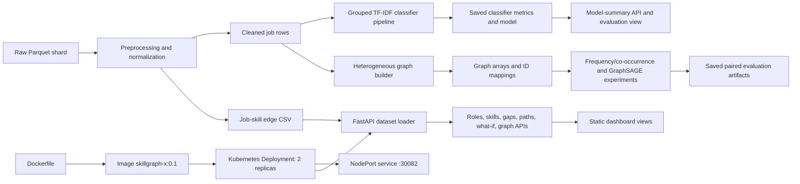

# SkillGraph-X: Advanced Machine Learning Project Report

**Assessment scope:** Advanced Machine Learning project, 40-mark rubric  
**Evidence checked:** 14 October 2026  
**Status:** Evidence-based report for the implementation and saved results currently in this workspace

## Abstract and Problem Statement

Job postings describe role requirements as unstructured text and lists of skills, making it difficult to compare a person's current skills with observed role requirements. SkillGraph-X processes a local job-posting corpus into job-skill records, exposes role analysis through a FastAPI service, and presents results in a multi-view dashboard. It also evaluates a text-based job-category classifier and a heterogeneous GraphSAGE link-prediction experiment. Saved paired results show that the current GraphSAGE recommender performs below frequency and co-occurrence baselines; the live skill-gap endpoint therefore remains a transparent frequency heuristic.

## Objectives and Contributions

- Build a reproducible path from a raw Parquet shard to cleaned job rows, job-skill edges, and deterministic graph mappings.
- Compare five text classifiers with a grouped validation/test design and preserve the selected classifier artifacts.
- Compare graph recommendation rankers under shared candidates and paired multi-seed edge splits.
- Provide role, skill-gap, path, what-if, graph, and model-summary views through a containerized API.
- Add current data/graph integrity checks and readable visual evidence without overwriting protected experiments.

## Executive Summary

SkillGraph-X is a dataset-backed workforce skill analysis application built around job postings and their recorded skill lists. Its web application serves role-based skill-gap recommendations, career-path suggestions, what-if comparisons, dataset summaries, and a sampled job-skill graph. Separately, the project contains a leakage-aware job-category classifier and a heterogeneous GraphSAGE link-prediction experiment.

The key experimental conclusion is negative but useful: in the saved five-seed paired K=10 ranking benchmark, GraphSAGE scores below both frequency and co-occurrence baselines on Precision, Recall, and NDCG. GraphSAGE remains experimental and is not the live recommendation method. The recommendation evaluation is transductive edge completion; it does not demonstrate temporal forecasting or cold-start performance.

The deployed Kubernetes service was verified during this project session: its Deployment had two available replicas, both pods were Running and Ready, the service had two pod endpoints, the health route returned HTTP 200, and all six dashboard views rendered in a browser without captured JavaScript console or page errors. Test and deployment evidence is detailed below, including evidence observed in a preceding verification pass rather than rerun while preparing this report.

## Data Engineering & Visualization

### Dataset and processing

The preprocessing implementation in [app/preprocess_dataset.py](app/preprocess_dataset.py) is configured to read `data/raw/train-00000-of-00001.parquet`. It requires `job_id`, `category`, `job_title`, `job_description`, and `job_skill_set`. Text is lowercased and whitespace-normalized. Skill lists are parsed from existing list values or Python-literal strings, normalized to lowercase, and deduplicated. Rows without a job ID, title, description, or at least one skill are removed; duplicate job IDs are reduced to one row. The output is a cleaned jobs CSV and a deduplicated job-skill edge CSV.

This pipeline parses skills already present in the source field; it does not implement or validate an independent skill-extraction model. The current processed dataset and model metadata record **1,167 jobs, 4,984 unique skills, 20,833 job-skill relationships, and five job categories**. The five classifier labels are business-development, finance, hr, information-technology, and sales.

The upstream dataset provider, license, collection date, and a formal data dictionary were not established by the inspected source files. The raw directory contains a single Parquet shard; the installed project environments have neither `pyarrow` nor `fastparquet`, so footer metadata could not be inspected. No source/license link is asserted here. Add verified provenance before submission if required by the course.

### Processed schema

Field meanings below are derived from the preprocessing and model code, not an upstream data dictionary.

| File | Field | Meaning and use |
| --- | --- | --- |
| `cleaned_jobs.csv` | `job_id` | Source posting ID; used for deduplication, grouping, and graph node mapping. |
| `cleaned_jobs.csv` | `category` | Job-category target for classification and role/category matching. |
| `cleaned_jobs.csv` | `job_title` | Normalized posting title; classifier text input and UI display metadata. |
| `cleaned_jobs.csv` | `job_description` | Normalized posting description; classifier text input. |
| `cleaned_jobs.csv` | `job_skill_set` | Original extracted skill-list field retained from the source. |
| `cleaned_jobs.csv` | `skills` | Lowercased, deduplicated skills serialized with ` | ` separators; classifier text and graph input. |
| `job_skill_edges.csv` | `job_id`, `job_title`, `category` | Posting key and descriptive metadata repeated on each relationship. |
| `job_skill_edges.csv` | `skill` | One normalized job-skill relationship value per row. |

The preprocessing script requires the raw source columns `job_id`, `category`, `job_title`, `job_description`, and `job_skill_set`; lowercases and whitespace-normalizes text; parses existing skill lists; removes records without ID/title/description/skills; keeps one row per job ID; and emits deduplicated edges. The audit validator checks the processed CSV schemas and edge consistency. It does not validate the inaccessible Parquet footer or establish upstream provenance.

### Graph construction

[app/heterogeneous_skill_graph.py](app/heterogeneous_skill_graph.py) builds a deterministic heterogeneous bipartite graph with `job` and `skill` node types and `requires` / `required_by` edge directions. Job and skill indices are stable sorted mappings. Job titles and categories are retained as descriptive metadata, not used as graph predictive features. Full graph arrays and mappings, plus training-only graph arrays and mappings, are saved under `data/processed/`.

The dashboard exposes a bounded job-skill graph sample and dataset summary. The graph endpoint describes this as a visualization of observed relationships, not a trained GNN.

### Architecture and data flow



The experiment runners are offline components; GraphSAGE ranking is not part of the live FastAPI recommendation path.

### Visualization evidence

The repository contains saved visualizations in `visualizations/`, including `top_skills.png`, `skill_gap_analysis.png`, the original graph/model comparison plots, `job_category_validation_scores_readable.png`, `paired_graph_benchmark_k10_with_ci.png`, `classifier_feature_ablation_v1.png`, and `job_category_best_confusion_matrix_labeled_v1.png`. The browser-verified UI also renders dataset summary and skill-distribution views. The new plots use saved metric JSON or inference verified against the saved classifier metadata. No user study or formal visualization-quality assessment was found.

**Estimated rubric mark: 7/8.** Processed data, deterministic graph artifacts, the integrity validator, summaries, and readable plots are implemented. Missing source provenance and a formal upstream data dictionary prevent full marks.

## Advanced Modeling & Pipeline Optimization

### Job-category classifier

The classifier in [app/job_category_model.py](app/job_category_model.py) combines normalized job title, description, and recorded skills into text features. Its word TF-IDF vectorizer uses unigrams and bigrams, sublinear term frequency, and an 8,000-feature cap. Five fixed candidates were compared: Logistic Regression, Linear SVM, Complement Naive Bayes, Random Forest, and XGBoost.

The held-out split uses the first fold of a shuffled five-fold `StratifiedGroupKFold` with seed 42. Leakage groups connect shared job IDs and near-duplicate text at character-hash cosine similarity of at least 0.95. Model selection uses three-fold grouped cross-validation on the training partition. The saved artifact records 935 training rows and 232 held-out rows. XGBoost uses 40 estimators, depth 3, learning rate 0.12, and 0.9 row and column subsampling; this is a fixed configuration, not evidence of an exhaustive hyperparameter search.

Saved results in `models/job_category_model_comparison.json` and `models/job_category_best_model_metadata.json` select **XGBoost + word_tfidf**:

| Metric | Saved result |
| --- | ---: |
| Validation macro-F1 | 0.9504 |
| Validation weighted-F1 | 0.9498 |
| Held-out test accuracy | 0.9784 |
| Held-out test macro-F1 | 0.9783 |
| Held-out test weighted-F1 | 0.9784 |

These are job-category classification results. They are not skill-recommendation ranking metrics and do not show that GraphSAGE is effective.

### GraphSAGE link prediction

[app/graphsage_link_prediction.py](app/graphsage_link_prediction.py) implements a two-layer heterogeneous GraphSAGE encoder using `SAGEConv` in both job-to-skill directions. It initializes trainable job and skill ID embeddings, applies ReLU and dropout between layers, and scores candidate edges with a learned diagonal bilinear scorer. The saved configuration uses hidden dimension 32, dropout 0.1, Adam learning rate 0.005, weight decay 0.0001, at most 60 epochs, and validation-based early stopping with patience 8.

This is an experimental transductive model. The graph has no validated numeric or text node-feature matrix; title and category are not model inputs. The model is not integrated into the live `/api/skill-gaps` method.

### Separate validation-only feature ablation

[app/run_classifier_feature_ablation.py](app/run_classifier_feature_ablation.py) ran three XGBoost feature variants on three grouped folds drawn from the outer training partition only. The experiment used 933 outer-training rows, random state 42, the repository's word-TF-IDF configuration, and XGBoost settings recorded in `experiments/classifier_feature_ablation_v1.json`. It used **zero held-out test rows** and wrote only that new JSON and `visualizations/classifier_feature_ablation_v1.png`.

| Feature set | Mean validation macro-F1 | Fold standard deviation |
| --- | ---: | ---: |
| Title + description + skills | 0.9542 | 0.0076 |
| Title + description (without skills) | 0.9701 | 0.0068 |
| Title + skills (without description) | 0.9649 | 0.0111 |

These results suggest that, under this particular split and environment, including all text fields did not improve validation macro-F1 over the two ablated variants. They do not establish a better final model: the experiment used only three folds and scikit-learn 1.9.1, while the canonical saved classifier reproduces under scikit-learn 1.6.1. The resulting ablation outer split had 933 training rows rather than the saved model's 935. Do not select a production model or claim a test improvement from this ablation.

The protected model, comparison JSON, metadata, baseline files, and integrity manifest were not regenerated. The saved classifier was loaded only for inference in the matching existing scikit-learn 1.6.1 environment; it exactly reproduced test accuracy `0.978448275862069`, test macro-F1 `0.9783055637375668`, and test weighted-F1 `0.9783831775424849` on the saved `935/232` grouped split. No classifier retraining occurred.

**Estimated rubric mark: 7/10.** The project has a leakage-aware classification pipeline, multiple candidates, a graph model, and a controlled validation-only feature ablation. Deductions remain for limited tuning/ablation breadth, environment-dependent split variation, ID-only transductive graph features, and GraphSAGE's inferior paired ranking results.

## Benchmarking & Comparative Analysis

### Paired graph-recommendation protocol

The primary direct comparison is `models/paired_graph_benchmark_evaluation.json`, produced by [app/run_paired_graph_benchmark.py](app/run_paired_graph_benchmark.py). It uses five seeds (43, 47, 53, 59, 61). For each seed, a per-job edge split preserves at least one training edge; held-out edges are divided into validation and test. Test targets are excluded from message passing and baseline statistics. All three rankers use the same filtered training-visible candidate skills per test job. Results are macro-averaged by test job. Precision@K divides hits by K, Recall@K by all held-out relevant skills, and NDCG uses binary relevance.

The following are five-seed means at K=10 from that paired artifact; paired differences are GraphSAGE minus each baseline. Values are rounded to four decimals.

Every seed used 16,222 training edges; validation had 2,372-2,374 edges, test had 2,237-2,239 edges, and 1,165-1,167 test jobs. Training-visible candidate vocabulary sizes ranged from 4,128 to 4,202. The artifact gives each seed's exact counts. Held-out validation/test edges are excluded from message passing and baseline statistics. The same per-job candidate set is used for each ranker.

| Ranker | Precision@10 | Recall@10 | NDCG@10 |
| --- | ---: | ---: | ---: |
| Frequency | 0.0550 | 0.2970 | 0.2390 |
| Co-occurrence | 0.0570 | 0.3067 | 0.2493 |
| GraphSAGE | 0.0508 | 0.2727 | 0.2190 |
| GraphSAGE minus frequency | -0.0043 | -0.0243 | -0.0200 |
| GraphSAGE minus co-occurrence | -0.0063 | -0.0340 | -0.0303 |

The saved paired 95% Student-t intervals across five seed-level differences are below. Every interval is below zero, but the sample contains only five seeds, so these intervals are approximate and describe seed/split variability.

| Paired difference (GraphSAGE minus baseline) | Precision@10 95% CI | Recall@10 95% CI | NDCG@10 95% CI |
| --- | ---: | ---: | ---: |
| vs. frequency | [-0.0068, -0.0017] | [-0.0391, -0.0096] | [-0.0360, -0.0040] |
| vs. co-occurrence | [-0.0086, -0.0039] | [-0.0466, -0.0215] | [-0.0450, -0.0156] |

**Finding:** GraphSAGE underperformed both simple baselines on all three paired K=10 ranking metrics. The co-occurrence baseline had the highest saved mean scores in this comparison. This report does not claim that GraphSAGE is the best recommender.

GraphSAGE also has secondary 1:1 sampled-negative link-classification metrics in saved artifacts. Those ROC-AUC and average-precision values are a different task and are not interchangeable with full-candidate ranking results. The single-seed `models/graphsage_link_prediction_evaluation.json` uses a different split from the five-seed paired benchmark; its values are not combined with the table above.

### Scope and limitations of the experiment

The graph recommendation experiment is **transductive edge completion**: evaluated jobs retain their non-held-out edges in the graph. Skills not observed in training are outside the recommendation candidate vocabulary. The benchmark does not evaluate unseen-job cold start, future job postings, temporal forecasting, or performance under a temporal split. Per-job edge splitting also does not eliminate possible semantic leakage from near-duplicate postings with different IDs. Sampled unobserved pairs may be undiscovered positives. The five-seed intervals are based on a small number of seeds, and no external research comparison or ablation study was found.

**Estimated rubric mark: 8/10.** The paired five-seed comparison, shared candidate sets, saved per-job differences, and uncertainty estimates provide strong comparative evidence. The small seed count and transductive/data limitations prevent a stronger claim.

## Deployment Procedure and Evidence

The deployment configuration is in [app/Dockerfile](app/Dockerfile), [k8s/deployment.yaml](k8s/deployment.yaml), and [k8s/service.yaml](k8s/service.yaml). It specifies `python:3.11-slim`, image `skillgraph-x:0.1`, container port 8000, two replicas, `/api/health` readiness/liveness probes, resource requests/limits, and NodePort 30082.

Documented commands from the project root for a controlled image build and first deployment are:

```powershell
docker build -f app/Dockerfile -t skillgraph-x:0.1 .
kubectl apply -f k8s/deployment.yaml
kubectl apply -f k8s/service.yaml
kubectl rollout status deployment/skillgraph-x
```

The build/apply commands above are instructions, **not commands claimed as executed in this audit**. The image was present locally and `docker image inspect` reported ID `sha256:fe33f7a58fc990541e7fd96fc82e0aec3c65515e4047bd89cde092accc19b7f2`; `docker ps --filter ancestor=skillgraph-x:0.1` showed no standalone Docker container. Kubernetes containers run as pods and need not appear as standalone CLI containers.

Safe status and smoke-check commands:

```powershell
kubectl config current-context
kubectl get nodes
kubectl get deployments,pods,services
kubectl get endpoints skillgraph-x-service
kubectl port-forward service/skillgraph-x-service 8003:8000
curl.exe -i http://127.0.0.1:8003/api/health
curl.exe -i http://127.0.0.1:8003/
```

The port-forward command must remain running in a separate terminal. For rollback after a failed update, inspect `kubectl rollout history deployment/skillgraph-x`; if a previous revision exists, `kubectl rollout undo deployment/skillgraph-x` is the documented rollback. These apply/rollback commands were not executed because the deployment was already healthy. No NodePort or manifest was changed.

## API, UI, and Deployment

### Application features

[app/main.py](app/main.py) implements the FastAPI service, request validation, and dataset loading. Implemented routes include `/api/health`, `/api/roles`, `/api/top-skills`, `/api/skill-graph`, `/api/skill-gaps`, `/api/career-paths`, `/api/what-if`, `/api/model-summary`, and the read-only `/api/graph-benchmark-summary`, plus the dashboard at `/` and API documentation at `/docs`. Skill-gap responses include threshold-qualified requirements with observed job counts and frequencies for local coverage recalculation.

The six original browser views remain: Overview, Skill Graph, Skill Gaps, Career Paths, What-if Analysis, and Model Evaluation. A seventh, Skill Intelligence, adds role profiles, category-skill overlap heatmap, bounded-sample skill co-occurrence, browser-local personal plans, and an interactive data story. Related category profiles use Jaccard overlap over skills passing the 20% threshold. Career comparisons query the existing route endpoint for up to three targets; what-if examples use skills returned by the selected role's API. These are data-backed heuristics, not causal forecasts or job-success probabilities. No salary, demand, certification, LLM, authentication, or cloud-sync features are claimed.

### Docker and Kubernetes configuration

[app/Dockerfile](app/Dockerfile) uses `python:3.11-slim`, installs `app/requirements-container.txt`, copies the API, static assets, processed job-skill edges, and classifier summary metadata, and serves Uvicorn on container port 8000.

[k8s/deployment.yaml](k8s/deployment.yaml) declares image `skillgraph-x:0.1`, two replicas, port 8000, HTTP readiness and liveness probes on `/api/health`, and CPU/memory requests and limits. [k8s/service.yaml](k8s/service.yaml) declares a NodePort service on port 8000 with NodePort 30082.

### Verification evidence

**Kubernetes and browser verification observed on 14 October 2026:**

- `kubectl config current-context` returned `docker-desktop`; `kubectl cluster-info` reached the API server and CoreDNS.
- `kubectl get nodes` reported `desktop-control-plane` as `Ready`.
- `kubectl get deployments,pods,services` reported `deployment/skillgraph-x` at `2/2` ready and available; pods `skillgraph-x-5d6c7d9d7d-86gp9` and `skillgraph-x-5d6c7d9d7d-l4lj7` were each `1/1 Running`.
- `skillgraph-x-service` reported `8000:30082/TCP`; `kubectl get endpoints skillgraph-x-service` returned `10.244.0.6:8000,10.244.0.8:8000`.
- With `kubectl port-forward service/skillgraph-x-service 8003:8000` running in a separate terminal, `/api/health` returned HTTP 200 and `{"status":"ok","service":"SkillGraph-X","dataset_loaded":true,...}`. A GET of `/` returned HTTP 200 with `text/html` and a 20,557-byte body.
- Browser automation visited all six views at port 8003. Each view had non-empty rendered content; the captured run had zero console errors and zero uncaught page errors.
- `docker info` returned Docker Desktop server information. A separate image-build log or immutable image digest was not captured during this verification.

**Source preview and feature verification, 14 October 2026:** the edited workspace ran separately at `http://127.0.0.1:8004/`; this did not rebuild, apply, or change the Kubernetes image. The seven views rendered nonblank content. Checks exercised the D3 graph's 172 nodes/957 links, node selection/neighborhood and search dimming, a 5-row/90-cell category heatmap, role profile and related categories, 15 sample skill-pair counts, gap checklist coverage changes, three-target route results, role-derived what-if (+5.9 percentage points), all five classifier rows, three paired rankers, and two paired-difference rows. JSON/CSV exports were inspected from generated browser blobs. Captured console/page errors were zero.

Responsive/browser checks at 1440, 768, and 390 CSS pixels showed no document-level horizontal overflow after a fix to the model-table wrapper; the table scrolls inside its own container. Mobile navigation, Intelligence tab keyboard controls, and reduced-motion behavior were checked. Screenshots were captured in the browser but were not saved as project files.

**Final full test run after UI/API changes:** `69 passed, 5 warnings in 43.92 seconds`, exit code `0`, using the project's `app/.venv` interpreter with pytest caching and Python bytecode disabled. Warnings were one PyTorch TorchScript deprecation and four scikit-learn unpickle-version warnings from loading the saved classifier under scikit-learn 1.9.1 instead of its 1.6.1 creation environment. The core career-path tests passed after replacing repeated title scans with a single grouped profile pass; the measured Finance-to-Sales calculation improved from 9.162 seconds to 1.082 seconds on the same 20,833-edge dataframe and returned five routes. The saved classifier's metrics were separately reproduced exactly under the existing 1.6.1 environment without retraining.

The manifest at `models/phase2_integrity_manifest.json` lists five protected classifier artifacts. Read-only SHA-256 and size checks matched all five against the manifest generated on 2026-10-13. This confirms current contents match that manifest; it does not establish integrity before manifest creation. The protected paired benchmark files were read and verified against their result JSON but have no entry in this Phase 2 manifest.

**Estimated rubric mark: 7/8.** The container definition, two-replica deployment, probes, unchanged NodePort, live endpoints, health response, and browser UI were verified. A reproducible build log and production deployment/security evidence are not included.

## Rubric Summary and Estimated Marks

These are evidence-based estimates only; they are not a guaranteed grade.

| Rubric category | Estimate | Brief justification |
| --- | ---: | --- |
| Data Engineering & Visualization | 7/8 | Dataset checks, consistency report, deterministic graph artifacts, and readable plots are present; upstream source/license and formal data dictionary are missing. |
| Advanced Modeling & Pipeline Optimization | 7/10 | Leakage-aware classifier, saved-metric reproduction, and validation-only ablation are evidenced; broad tuning is absent, ablation is version-sensitive, and GraphSAGE is inferior to baselines. |
| Benchmarking & Comparative Analysis | 8/10 | Five-seed paired ranking comparison and saved confidence intervals; small seed count and transductive scope remain limitations. |
| Deployment & Containerization | 7/8 | Docker/Kubernetes configuration and live two-pod service/browser verification; no reproducible build log or production hardening evidence. |
| Documentation & Report | 3/4 | Report maps claims to implementation and verified publications; dataset provenance/license and final screenshot/presentation package remain outstanding. |
| **Estimated total** | **32/40** | **Estimate only; instructor rubric interpretation may differ.** |

### Score range

- **Conservative: 29/40** if limited tuning, unavailable dataset provenance, and the transductive recommender scope are weighted heavily.
- **Most likely: 32/40** based on the implementation, newly verified data checks, validation-only ablation, paired benchmark, live deployment, and full test pass.
- **Optimistic: 34/40** if the evaluator gives strong credit for the deployment and reproducibility work while accepting the unresolved provenance and model limitations.

The 38-39/40 target is not supported by current evidence: there is no verified data source/license, extensive model search or ablation program, temporal/cold-start evaluation, external benchmark comparison, or captured clean Docker build record. The 32/40 estimate above predates the product redesign and has not been recalculated for this source update.

## Remaining Evidence and Limitations

1. Add the dataset's verified origin, license, collection date, and data dictionary; do not infer these from the parquet filename.
2. Add external research references and explain the benchmark relationship to them if required by the assignment. No citations have been invented for this report.
3. Add recorded tuning/ablation evidence if the rubric expects optimization beyond the saved fixed configurations.
4. Keep the recommender claim narrow. A future model should use validated node features and be evaluated on temporal and unseen-job splits before any cold-start or forecasting claim.
5. Preserve existing results and capture a reproducible Docker build/image digest and final screenshots or demo evidence if requested for submission.

## References

1. W. L. Hamilton, R. Ying, and J. Leskovec, “Inductive Representation Learning on Large Graphs,” *Advances in Neural Information Processing Systems (NeurIPS)*, 2017. Verified publication record and paper: [arXiv:1706.02216](https://arxiv.org/abs/1706.02216). The project implementation is transductive and does not claim the inductive results of this paper.
2. T. Chen and C. Guestrin, “XGBoost: A Scalable Tree Boosting System,” *Proceedings of the 22nd ACM SIGKDD International Conference on Knowledge Discovery and Data Mining (KDD ’16)*, 2016. Verified paper record: [arXiv:1603.02754](https://arxiv.org/abs/1603.02754); related DOI: [10.1145/2939672.2939785](https://doi.org/10.1145/2939672.2939785).

These references support methods used in the project. They are not citations for the dataset. No dataset citation or license is asserted because none was found in the repository or inspectable Parquet metadata.

## Conclusion

The verified project is a functional workforce skill-analysis prototype with reproducible processed-data checks, a leakage-aware classifier, a heterogeneous graph experiment, paired ranking benchmarks, tested API routes, and a live two-replica Kubernetes deployment. The strongest ranking result remains the co-occurrence baseline, not GraphSAGE. Current marks are estimates only; source provenance, broader modeling work, and out-of-distribution evaluation remain the main limitations.

## Evidence Index

- Data and processing: [app/preprocess_dataset.py](app/preprocess_dataset.py), [app/skillgraph_core.py](app/skillgraph_core.py), `data/processed/cleaned_jobs.csv`, `data/processed/job_skill_edges.csv`.
- Graph construction: [app/heterogeneous_skill_graph.py](app/heterogeneous_skill_graph.py), `data/processed/heterogeneous_skill_graph.npz`, `data/processed/heterogeneous_skill_graph_mappings.json`, and training-graph equivalents.
- Classifier: [app/job_category_model.py](app/job_category_model.py), `models/job_category_model_comparison.json`, `models/job_category_best_model_metadata.json`.
- Recommendation benchmarks: [app/run_paired_graph_benchmark.py](app/run_paired_graph_benchmark.py), `models/paired_graph_benchmark_evaluation.json`, `models/paired_graph_benchmark_per_job_differences.csv`, `models/graph_recommendation_baselines.json`, and `models/graphsage_link_prediction_evaluation.json`.
- API and tests: [app/main.py](app/main.py), [app/static/index.html](app/static/index.html), [app/static/app.js](app/static/app.js), [tests/test_api_routes.py](tests/test_api_routes.py), and other files under `tests/`.
- Deployment: [app/Dockerfile](app/Dockerfile), [k8s/deployment.yaml](k8s/deployment.yaml), and [k8s/service.yaml](k8s/service.yaml).

## Evidence Handling

No model, split, benchmark, protected plot, dependency version, NodePort, or Kubernetes resource was modified for the product redesign. New UI charts use existing API data or saved benchmark JSON. The local source preview is separate from the running Kubernetes image; its new UI and benchmark-summary endpoint are not deployed to Kubernetes until an authorized future image build and rollout.